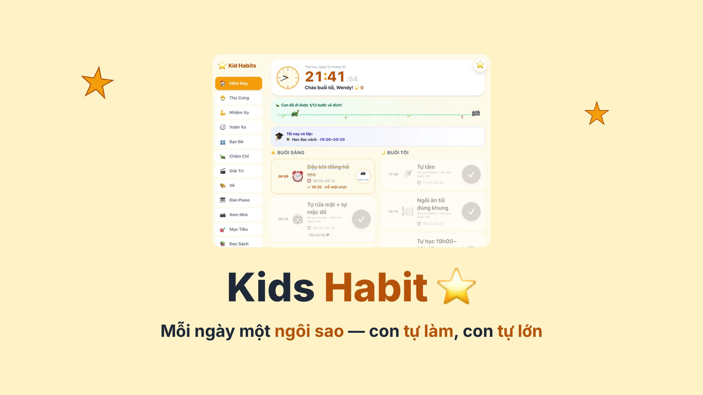
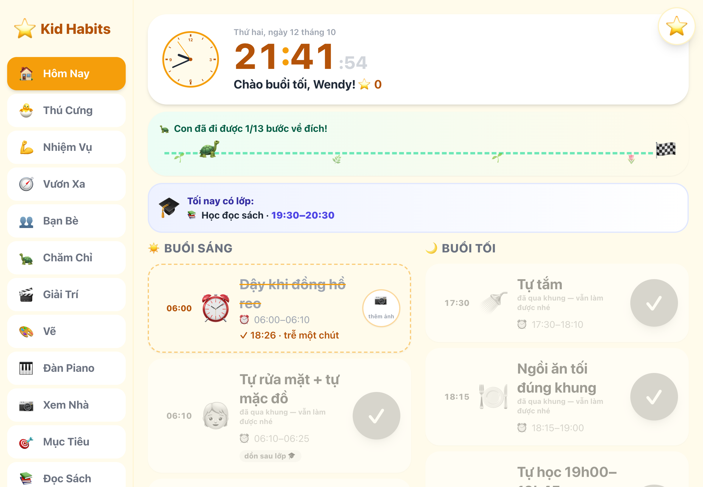
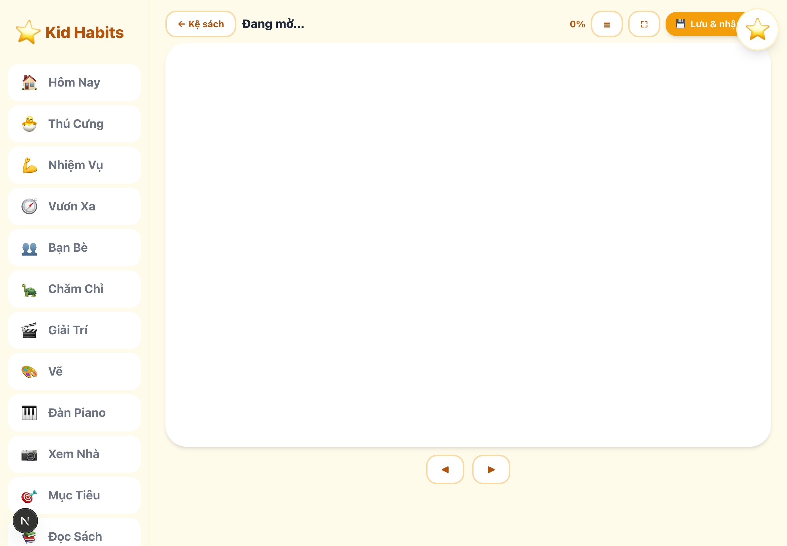
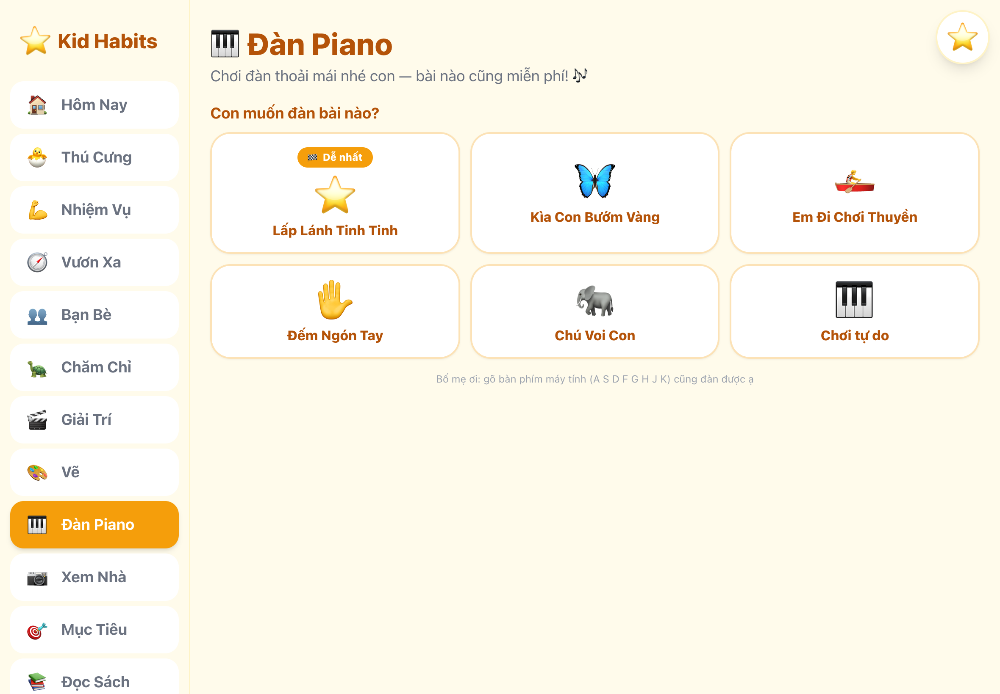
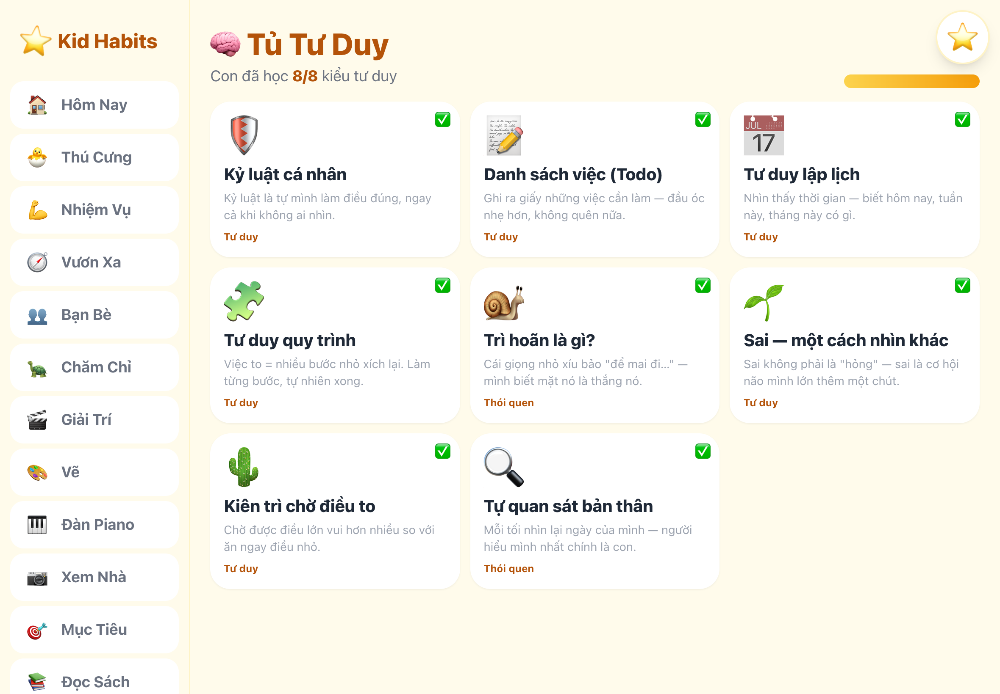
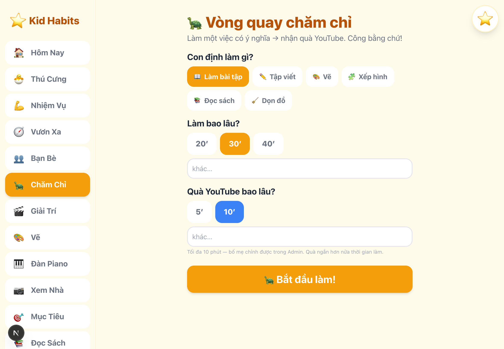
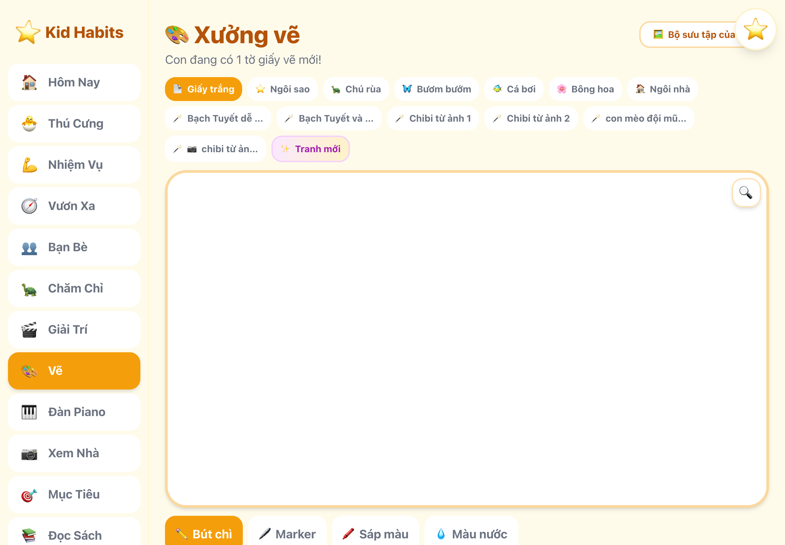
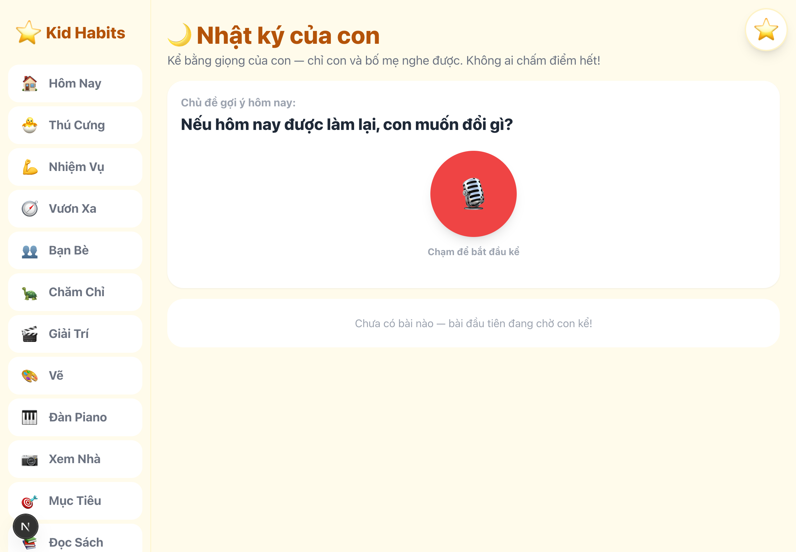

# Kids Habit ⭐

> Mỗi ngày một ngôi sao — con tự làm, con tự lớn.

**Một sản phẩm của [Linh An Solutions](https://linhan.solutions)** — open source cho mọi gia đình.

Webapp checklist hằng ngày cho trẻ 5–8 tuổi. Con tự tick việc, tự tích sao, tự đổi quà. Phần thưởng nằm trên nền nghiên cứu tâm lý học, không phải điểm số vô tri.

App này tồn tại vì một lý do cụ thể: bản demo chạy thật mỗi tối cho một cô bé 6 tuổi lớp 1.

## Video giới thiệu

[](docs/demo/kids-habit-launch.mp4)

**[▶ Xem video giới thiệu — 1:58](docs/demo/kids-habit-launch.mp4)** — vì sao phần lớn app thói quen làm ngược khoa học, Kids Habit làm thế nào khác, và đoạn [journal thật](#tính-năng) của con sau ngày đầu tiên sử dụng.

Bản dọc cho Reels/Shorts: [kids-habit-reel-9x16.mp4](docs/demo/kids-habit-reel-9x16.mp4).

## Màn hình chính

| Trang chủ — việc hôm nay | Đọc sách EPUB — chữ to, lưu vị trí |
|---|---|
|  |  |

| Piano luyện ngón | Tủ Tư Duy |
|---|---|
|  |  |

| Pomodoro có điểm kết thúc | Xưởng vẽ |
|---|---|
|  |  |

| Nhật ký giọng nói |
|---|
|  |

## Vì sao khác các app thói quen khác

Phần lớn app cho trẻ làm ngược research. Kids Habit đi theo chiều ngược lại:

| App thường làm | Kids Habit làm | Cơ sở |
|---|---|---|
| Khen "Con giỏi quá!" | **Mô tả hành vi**, không đánh giá | Kohn, Dweck, Faber & Mazlish, Siegel |
| Thưởng việc con đã thích (đọc sách) | Việc nhóm A **0 sao** — không đụng động lực nội tại | Lepper 1973 (over-justification) |
| Streak đứt là mất hết | **Streak mềm** — miss 1 ngày không reset | Lally 2010 (thói quen cần ~66 ngày) |
| Trễ giờ là trừ sao, mắng | Trễ vẫn được tick, lời nhắn connect-then-redirect | Tự chủ hơn áp đặt |
| Thưởng mãi không dứt | **Tốt nghiệp**: ≥80% đúng giờ 4 tuần → việc rời hệ sao (fading) | Self-determination theory |

## Tính năng

- ✅ **Checklist hằng ngày** — khung giờ cứng (ăn, học, ngủ), con tự tick, ảnh check-in tùy chọn
- ⭐ **Sao & Cửa hàng** — tích sao đổi quà thực: đi công viên, thời gian chơi cùng bố mẹ. Point ledger append-only
- 🐱 **Thú cưng "Sao Nhí"** — lớn lên theo sự chăm chỉ của con, chỉ nói lời mô tả
- 📚 **Thư viện EPUB** — chữ to cho tuổi mới biết đọc, thưởng sao có trần
- 🎹 **Đàn piano Synthesia** — nốt rơi, touch, bài tập có điểm kết thúc
- 🎨 **Xưởng vẽ & tranh tô màu AI** — check-in tặng 1 tờ giấy vẽ (nguyên lý Premack); sinh mẫu tranh tô từ ảnh chụp qua Gemini
- 📹 **Camera nhà** — HLS live 2 lens, chỉ trong LAN, mọi route kiểm tra quyền
- 🍅 **Pomodoro trẻ em** — làm 20/30/40 phút, quà video 5/10 phút tự tắt
- 📝 **Nhật ký giọng nói** — con kể chuyện bằng giọng mình, nghe lại về sau
- 🔥 **Streak & huy hiệu** — mốc 3/7/30 ngày
- 👨‍👩‍👧 **Đa gia đình** — nhiều con, mỗi con một scope dữ liệu riêng
- 🌙 **Paper mode khung 21h** — thiết bị không vào phòng ngủ (Carter 2016)

## Chạy local

```bash
npm install
npm run seed     # 13 việc checklist mẫu + 20 quà Kho Bí Mật
npm test         # unit tests (scoring + feedback guardrails)
npm run dev      # http://localhost:3210
```

Tài khoản demo sau khi seed: `kid/1234` (con) · `bo/1310` · `me/1310` (bố mẹ). Dùng thật thì đổi mật khẩu.

## Vai trò & bảo mật

- **Child** (iPad của con): vào thẳng `/` — không mật khẩu (cookie `kh_role=child`)
- **Parent**: `/parent` → PIN (env `PARENT_PIN`, mặc định `1310` — đổi khi deploy)
- Ảnh trẻ em nằm trong `data/photos/` trên máy gia đình, không cloud công khai; serve qua `/api/photo` có session
- Camera chỉ phát trong LAN, mọi route `/api/cam/*` kiểm tra role

## Guardrails giáo dục cài trong code (đừng bỏ khi đóng góp)

1. Nhóm việc **A** (đã thích — đọc sách) = **0 sao**, chống over-justification (Lepper 1973)
2. Sao Nhí **mô tả, không đánh giá** — danh sách từ cấm trong `src/lib/feedback.ts`, test fail nếu vi phạm
3. **Streak mềm** — miss 1 ngày không reset (Lally 2010)
4. **Trễ giờ không phạt** — vẫn +1 sao nhóm B, lời nhắn connect-then-redirect
5. **Tốt nghiệp** (fading) — ≥80% đúng giờ 4 tuần → việc rời hệ sao
6. Point ledger **append-only** — không có route update/delete
7. Paper mode khung 21h — thiết bị không vào phòng ngủ (Carter 2016)

## Cấu hình

Sao chép `.env.example` → `.env` nếu dùng camera, home automation, hay sinh ảnh AI. Không có các env này, app vẫn chạy đầy đủ tính năng chính.

## Deploy (Mac nhà — chạy 24/7)

```bash
KH_DEPLOY_HOST=your-mac-mini.local bash scripts/deploy.sh
```

- Build Next.js standalone → rsync → restart LaunchAgent (KeepAlive, RunAtLoad)
- Data production ở `data/` trên máy chủ — script deploy không ghi đè
- Truy cập từ xa: khuyến nghị Cloudflare Tunnel + Access

## Cấu trúc

- `src/lib/` — db (SQLite `node:sqlite`, không dependency ngoài), scoring, feedback engine, service, camera, home automation
- `src/app/` — Next.js 15 App Router: app của con (`/`, reading, piano, draw, pomodoro, journal, ideas…) + bố mẹ (`/review`, `/admin`, `/report`)
- `scripts/` — seed, test runner, deploy, watchdog
- `books/catalog.json` — danh mục sách (epub tự chuẩn bị, không kèm trong repo)

## Đóng góp

Xem [CONTRIBUTING.md](CONTRIBUTING.md). PR kèm test. Thay đổi nào đụng guardrails giáo dục phía trên cần dẫn nguồn nghiên cứu.

## Giấy phép

Kids Habit là một sản phẩm của [Linh An Solutions](https://linhan.solutions).

[MIT](LICENSE) — dùng tự do cho gia đình bạn. Nếu sản phẩm của bạn derives từ Kids Habit, giữ tinh thần trẻ em trước tiên: không quảng cáo, không data lên cloud công khai, không dark pattern giữ chân trẻ.

---

*"Mỗi ngày một ngôi sao — con tự làm, con tự lớn."*
